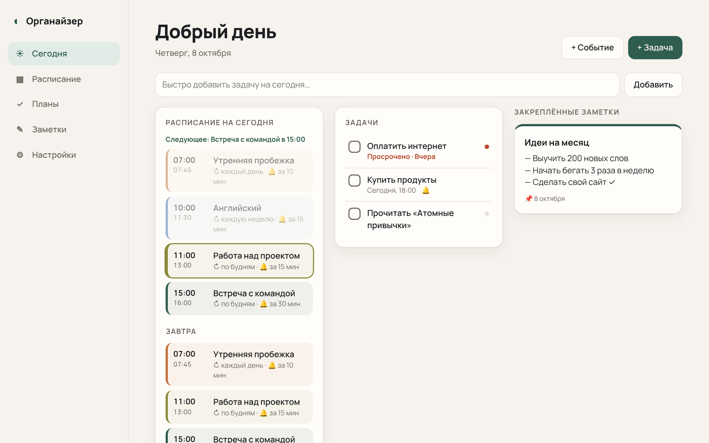
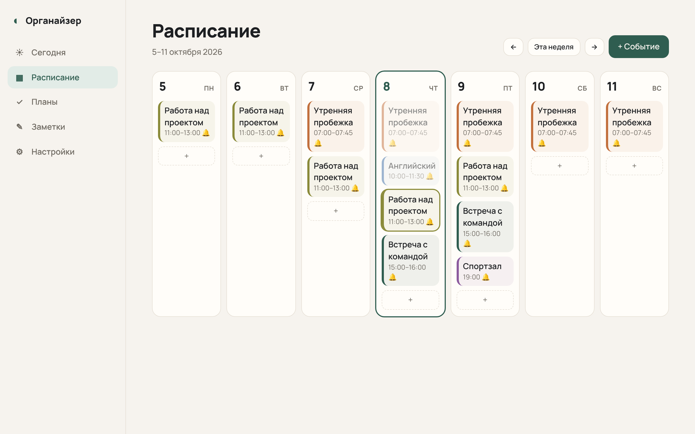
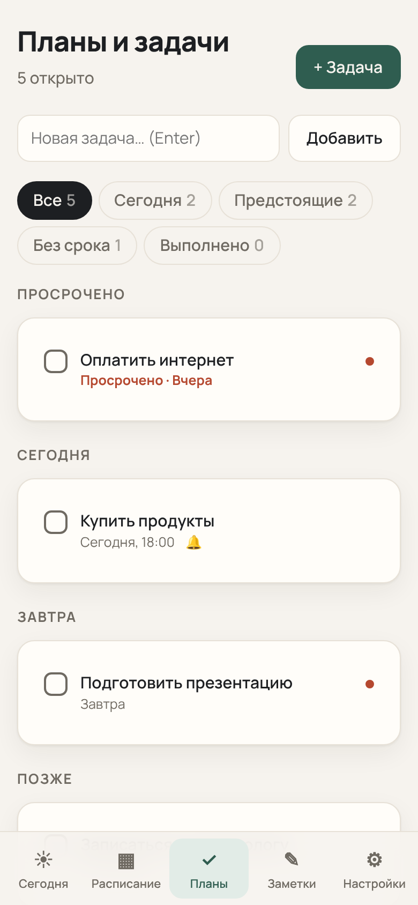
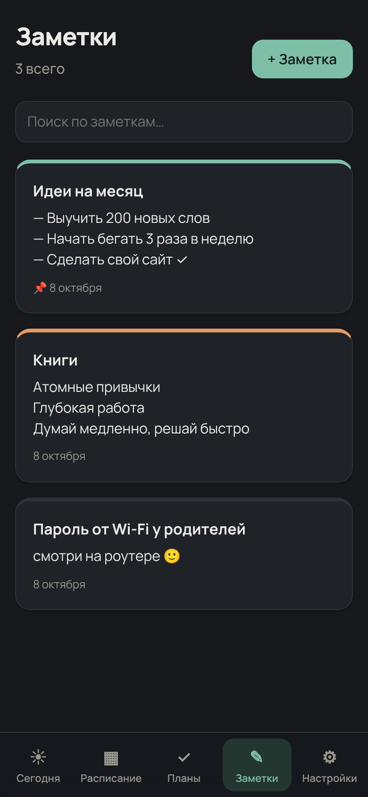

# Reminder: personal organizer

A self-hosted web app for my schedule, plans and notes. It sends reminders as browser push notifications and through a personal Telegram bot.



## Features

- **Today dashboard**: today's schedule with the next event highlighted, open and overdue tasks, pinned notes, and a quick-add field.
- **Weekly schedule**: events that repeat daily, on weekdays, weekly, monthly or yearly, each with its own color and reminder.
- **Tasks**: due date, time, priority and reminder. Tasks are grouped into Overdue, Today, Tomorrow, Later and No date.
- **Notes**: full-text search, colors and pinning.
- **Reminders**:
  - Web Push (VAPID) that works even when the tab is closed;
  - a Telegram bot;
  - a morning digest with the plan for the day.
- **Telegram bot commands**: `/today`, `/tomorrow`, `/tasks`, `/task <text>`, `/note <text>`. Any other text is saved as a note.
- **Installable PWA** with light and dark themes and a mobile layout with a bottom tab bar.
- **Password protection**, plus JSON export and import.

| Schedule | Tasks (mobile) | Notes (dark) |
|---|---|---|
|  |  |  |

## Tech stack

- **Backend**: Node.js and Express, with storage in a JSON file and atomic writes.
- **Scheduler**: runs every 30 seconds and catches up on missed reminders after a restart. Each reminder is sent once.
- **Notifications**: `web-push` for Web Push. The Telegram Bot API is called with plain `fetch` long polling, without a bot library.
- **Frontend**: vanilla JS, HTML and CSS with no build step and no framework. A service worker handles push.
- **Shared code**: the repeat-rule logic (`public/shared.js`) runs on both the server and the browser.

## Run locally

```bash
git clone https://github.com/Javharr/reminder.git
cd reminder
npm install
cp .env.example .env
npm start
```

Open http://localhost:3000.

### Environment variables

| Variable | Description |
|---|---|
| `APP_PASSWORD` | Password for the site. Required when the app is public. |
| `TELEGRAM_BOT_TOKEN` | Bot token from [@BotFather](https://t.me/BotFather). Optional. |
| `TZ` | Time zone for reminders. The default is `Asia/Tashkent`. |
| `PORT` | Port. Railway sets it automatically. |
| `DATA_DIR` | Data folder. On Railway the volume path is picked up automatically. |

## Deploy on Railway

1. Create a project with **New Project → Deploy from GitHub repo** and choose this repository.
2. Add a **Volume** to the service and mount it at `/data`. Data and push keys are stored there, so they survive redeploys.
3. In **Variables**, set `APP_PASSWORD`. Add `TELEGRAM_BOT_TOKEN` too if you want the bot.
4. Go to **Settings → Networking → Generate Domain**.

## Telegram setup

1. Message [@BotFather](https://t.me/BotFather), send `/newbot`, and copy the token.
2. Add it as `TELEGRAM_BOT_TOKEN` and restart the app.
3. In the app, open **Settings → Connect Telegram** and press **Start** in the bot.

The bot links only to the chat that uses the one-time link code, so nobody else can use it.

---

## По-русски

Личный органайзер: расписание, планы, заметки и напоминания в браузер и в Telegram.

Запуск: `npm install`, затем `npm start`, затем откройте http://localhost:3000. Настройки задаются в `.env` (образец в `.env.example`).

## License

MIT
